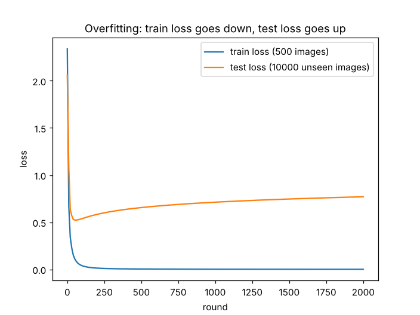
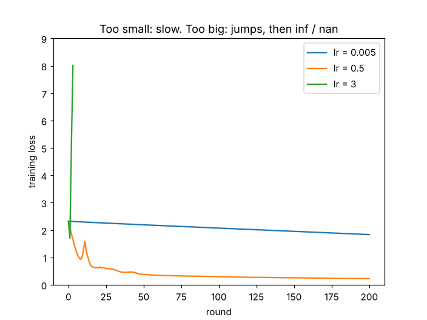
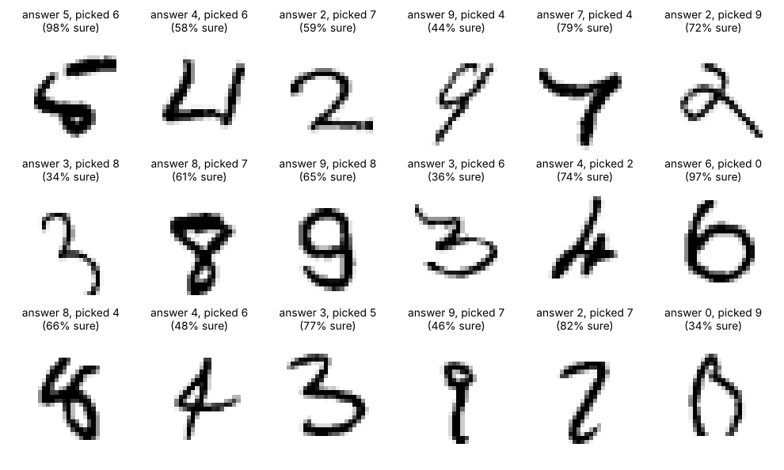
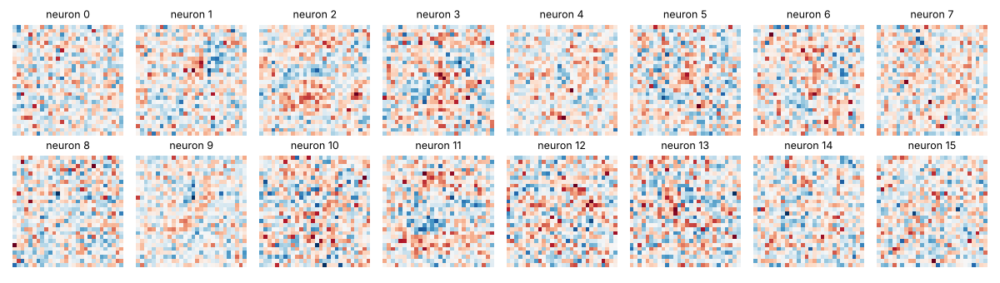
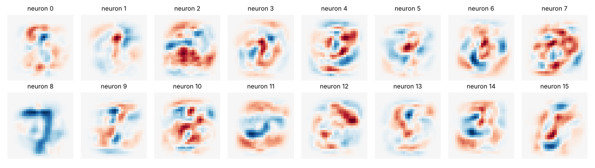

# Handwritten digits (MNIST) with PyTorch

A small network that reads 28 × 28 handwritten digits and says which digit (0–9) it is.
It is trained with plain gradient descent on the MNIST data set: 60,000 training images, plus 10,000 test images written by different people and never used for training.

All scripts run on a CPU in a minute or two. They download MNIST automatically.

```
pip install torch torchvision matplotlib
python 1_no_hidden_layer.py
```

## Files

| File | What it does |
|---|---|
| `1_no_hidden_layer.py` | 784 pixels → 10 scores, one neuron per digit, all weights start at 0 |
| `2_hidden_layer.py` | 784 → 100 hidden neurons (ReLU) → 10 scores; reports training and test accuracy; saves `net.pt` |
| `3_zero_hidden_layer.py` | Same network, every weight starts at 0 (broken on purpose) |
| `4_overfit_500.py` | Same network trained on only 500 images for 2,000 rounds |
| `5_learning_rate.py` | Same network with learning rates 0.005, 0.5 and 3 |
| `6_look_inside.py` | Draws the hidden neurons' weights and the test images the network gets wrong (run `2_hidden_layer.py` first) |

Every script uses the same loop: clear gradients → forward → cross-entropy loss → `backward()` → `step()`. Test images only go through the forward pass and the accuracy check; they never move a weight.

## Results

| Experiment | Training set | Test set |
|---|---|---|
| No hidden layer, round 0 (all weights 0) | loss 2.303, accuracy 9.9% | |
| No hidden layer, 100 rounds | 89.5% | |
| 100 hidden neurons, random start, 200 rounds, lr 0.5 | 93.6% | 93.5% (653 of 10,000 wrong) |
| 100 hidden neurons, all weights start at 0 | stuck at 11.2% | |
| Only 500 training images, 2,000 rounds | 100%, loss 0.0007 | 84.0%, loss 0.52 → 0.77 |
| lr 0.005, 200 rounds | 58.6%, loss 1.83 | |
| lr 3 | loss inf at round 4, nan from round 5, stuck at 9.9% | |

## What happened along the way

**The starting loss can be checked by hand.** With every weight at 0, all 10 scores are 0, softmax gives each digit 1/10, and the loss is −ln(1/10) = 2.303. Every image gets the same answer (digit 0), so accuracy is the share of zeros, about 10%. The first printed round matched both numbers, which is a cheap way to know the code is not wrong.

**All-zero start in the hidden layer gets stuck at 11.2%.** Hidden outputs h are all 0, so the gradient of w2 (which is multiplied by h) is 0, and the gradient reaching h (which is multiplied by w2) is 0, so w1 never moves either. Only the last bias b2 can learn. The network gives every image the same answer, the most common digit, 1, and 11.2% is exactly the share of 1s in the training set. A small random start fixes it.

**Training accuracy alone cannot tell "learned" from "memorized".** A network that memorized every training image would score 100% on them and only guess on new ones. With 60,000 images the network scores 93.6% on training images and 93.5% on unseen test images, so what it learned carries over.

**Overfitting, on purpose.** The network has about 80,000 weights. Given only 500 images, it reaches 100% on them but 84% on the test set. Training loss keeps falling; test loss is lowest around round 50 and then rises. Test accuracy stays at 84% while test loss rises, because the images it gets wrong are getting wrong *more confidently*: the probability of the correct answer shrinks, so −log(p) grows.



**Learning rate.** 0.005 is not broken, just slow: after 200 rounds the loss is 1.83 instead of 0.227. At 3, each step overshoots the bottom and lands higher on the other side: 2.32, 1.70, 5.15, 8.01, inf, then nan. Once a weight is nan, `w − lr × grad` stays nan, and it spreads to every weight. All scores become nan, the network always picks digit 0, and accuracy sits at 9.9%.



**The mistakes.** Some of the 653 wrong test images are hard for a person too. Others are easy for a person. This network only looks at which pixels have ink, so a digit that is shifted or slanted puts its ink on different pixels than the weights expect.



**Looking at what a hidden neuron "likes": the first picture is misleading.** Each hidden neuron has 784 weights, one per pixel. Put back into 28 × 28 (red = positive, blue = negative), they look like random noise:



The reason: pixels near the border almost never have ink (67 pixels have no ink in any training image). With x = 0 the gradient of that weight is 0, so it never moves and still holds its random starting value. Drawing only how much each weight changed during training (`w1 − w1_start`) removes the starting noise. The border goes blank and stroke shapes appear. Neuron 8 is a blue 7: when a 7 comes in, its ink lands on negative weights, z gets smaller and ReLU outputs 0. It is not a neuron that likes 7s; it goes quiet when it sees one.



## How this was made

I am learning neural networks from zero with Claude as a tutor. Claude wrote most of this code and this README. Before each piece of code I worked through the same idea by hand with tiny numbers (a 5 × 5 image, 4 pixels, 3 images), and I matched every line of code to a step I had done by hand. All the numbers above come from actually running these scripts.

My first project, a backpropagation tool written from scratch, is [backprop-from-scratch](https://github.com/Acezhang08/backprop-from-scratch).

---

# 中文

一个认手写数字的小网络：看一张 28 × 28 的手写数字图，说出它是 0～9 里的哪一个。数据是 MNIST：6 万张训练图，还有 1 万张另一批人写的测试图，训练时一张都不用。

## 文件
- `1_no_hidden_layer.py`：784 个格子 → 10 个分数，每个数字一个神经元，旋钮全从 0 开始
- `2_hidden_layer.py`：784 → 100 个中间神经元（ReLU）→ 10 个分数，量训练图和测试图的准确率，存下 `net.pt`
- `3_zero_hidden_layer.py`：同一个网络，旋钮全设 0（故意弄坏）
- `4_overfit_500.py`：只用 500 张图练 2000 圈
- `5_learning_rate.py`：学习率 0.005、0.5、3 各跑一次
- `6_look_inside.py`：画中间神经元的旋钮、画认错的测试图（先跑 2）

每个脚本都是同一个循环：清坡 → 往前算 → 交叉熵损失 → `backward()` → `step()`。测试图只往前算、算准确率，从来不挪旋钮。

## 撞见的事
- **起点损失能手算**：旋钮全 0，10 个分数都是 0，每个数字概率 1/10，损失 −ln(1/10) = 2.303；全选数字 0，准确率约 10%。跑出来第 0 圈正好对上，说明代码没写错
- **中间层全 0 起点卡在 11.2%**：h 全是 0，w2 的坡要乘 h 是 0，h 收到的坡要乘 w2 也是 0，w1 也不动，只有 b2 能学。每张图都选最常见的数字 1，11.2% 正好是训练集里 1 的占比
- **只看训练图分不出“学会了”还是“背下来了”**：6 万张时训练 93.6%、测试 93.5%，学到的东西换一批图照样能用
- **故意过拟合**：8 万个旋钮只给 500 张图，训练 100%、测试 84%。训练损失一直降，测试损失第 50 圈左右最低，之后往上涨。测试准确率不动而损失涨，是因为认错的那些越来越“有把握地错”
- **学习率**：0.005 没坏，只是慢；3 每一步迈过头，损失 2.32、1.70、5.15、8.01、inf、nan。旋钮一旦 nan 就回不来，还传染给所有旋钮，准确率卡 9.9%
- **认错的图**：有些人也认不出；有些人一眼就认得。这个网络只看墨落在哪几个格子，字挪一点、歪一点就对不上
- **看神经元“喜欢”什么，第一眼是假象**：直接画旋钮是一片噪点。原因是四周的格子几乎没墨，坡是 0，旋钮从随机起点一直没动。只画训练中变了多少（`w1 − w1_start`）后，四周变白、出现笔画。神经元 8 是一个蓝色的 7：7 的墨落在负的旋钮上，z 变小，ReLU 后是 0。它不是喜欢 7，是看到 7 就不出声

## 怎么做出来的
我从零学神经网络，Claude 当老师。大部分代码和这份 README 是 Claude 写的。每段代码之前，我先用很小的数（5 × 5 的图、4 个格子、3 张图）手走一遍，再把代码一行一行对上手走的每一步。上面所有的数都是真跑出来的。
